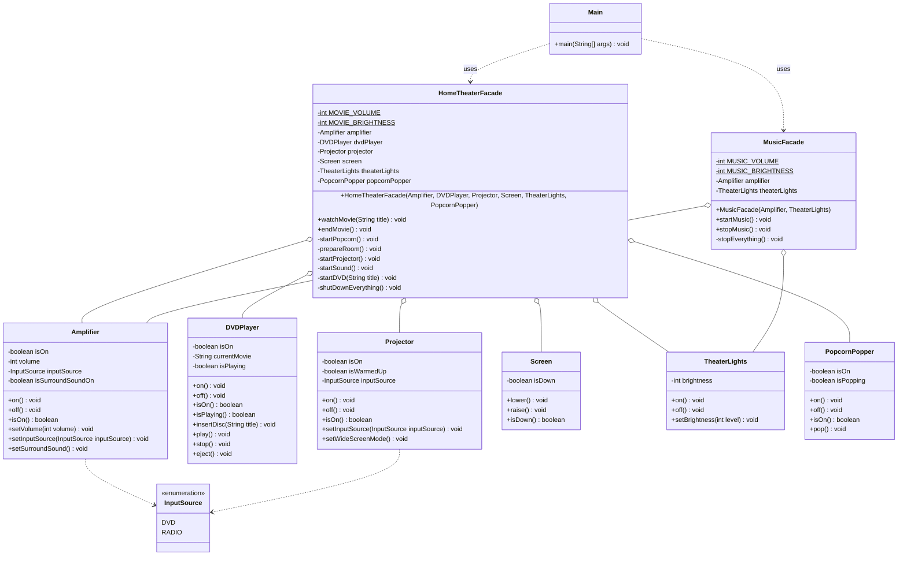

# Assignment 4 — Facade Pattern Report

## 1. Introduction

The domain of this project is a **home theater**. To watch a movie, many devices must be used in the correct order: the popcorn popper, the lights, the screen, the projector, the amplifier and the DVD player. Done by hand, this takes about 15 method calls, and the client must know the rules of every device (for example, the projector must warm up before its input can be set).

The **Facade pattern** gives one simple entry point to a complex subsystem. `HomeTheaterFacade` hides all the steps behind two methods, `watchMovie(title)` and `endMovie()`. A second facade, `MusicFacade`, offers `startMusic()` and `stopMusic()` using only the amplifier and the lights. The subsystem classes do not know about the facades and can still be used directly.

## 2. UML Class Diagram



## 3. Clean Code

### 3.1 A simple interface for a complex subsystem

The client should not know the order of 15 calls. The facade turns them into one call.

**Before**

```java
popcornPopper.on();
popcornPopper.pop();
theaterLights.setBrightness(10);
screen.lower();
projector.on();
projector.setInputSource(InputSource.DVD);
projector.setWideScreenMode();
amplifier.on();
amplifier.setInputSource(InputSource.DVD);
amplifier.setSurroundSound();
amplifier.setVolume(5);
dvdPlayer.on();
dvdPlayer.insertDisc("Inception");
dvdPlayer.play();
```

**After**

```java
homeTheater.watchMovie("Inception");
```

### 3.2 Meaningful names and small methods

`watchMovie` reads like a list of steps. Each step is a small private method with a clear name, and magic numbers are named constants.

**Before**

```java
public void watchMovie(String title) {
    popcornPopper.on();
    popcornPopper.pop();
    theaterLights.setBrightness(10);
    screen.lower();
    projector.on();
    ...
}
```

**After**

```java
private static final int MOVIE_VOLUME = 5;
private static final int MOVIE_BRIGHTNESS = 10;

public void watchMovie(String title) {
    startPopcorn();
    prepareRoom();
    startProjector();
    startSound();
    startDVD(title);
}
```

### 3.3 Single Responsibility

Each class has one job. Every device checks its own rules. The facade only coordinates the order of calls and does not repeat device logic. Music mode is in its own `MusicFacade`, so `HomeTheaterFacade` stays focused on movies.

**Before** — the facade checks device rules itself:

```java
public void startSound() {
    if (volume < 0 || volume > 100) {
        throw new IllegalArgumentException("Bad volume");
    }
    amplifier.on();
    amplifier.setVolume(volume);
}
```

**After** — the rule lives in the device that owns it:

```java
public void setVolume(int volume) {
    ensureOn();
    if (volume < MIN_VOLUME || volume > MAX_VOLUME) {
        throw new IllegalArgumentException("Volume must be between " + MIN_VOLUME + " and " + MAX_VOLUME);
    }
    this.volume = volume;
}
```

### 3.4 Dependency injection and loose coupling

The facades receive their devices in the constructor instead of creating them. Devices can be shared (both facades use the same `Amplifier` and `TheaterLights`), and the subsystem classes never depend on the facades.

**Before**

```java
public class HomeTheaterFacade {
    private final Amplifier amplifier = new Amplifier();
    private final TheaterLights theaterLights = new TheaterLights();
}
```

**After**

```java
public MusicFacade(Amplifier amplifier, TheaterLights theaterLights) {
    this.amplifier = amplifier;
    this.theaterLights = theaterLights;
}
```

### 3.5 Safe error handling (rollback)

If one step fails, the system should not stay half-on. The facade catches the error, turns off everything that was already started, and reports one clear message.

**Before**

```java
public void watchMovie(String title) {
    startPopcorn();
    prepareRoom();
    startProjector();
    startSound();
    startDVD(title);
}
```

**After**

```java
public void watchMovie(String title) {
    try {
        startPopcorn();
        prepareRoom();
        startProjector();
        startSound();
        startDVD(title);
    } catch (RuntimeException e) {
        shutDownEverything();
        throw new IllegalStateException("Could not start the movie: " + e.getMessage(), e);
    }
}
```

## 4. Conclusion

The Facade pattern made the home theater easy to use. The client calls `watchMovie` and `endMovie` instead of many calls in a strict order, and it does not need to know any device rules. Errors are handled in one place with a rollback, and new scenarios (like music mode) can be added as new facades without changing the devices.

The cost is extra classes and one more layer between the client and the devices. A facade can also grow too big if it takes on too many scenarios, which is why music mode was moved to a second facade. The subsystem is still public, so advanced clients that need full control can use the devices directly.

## 5. GitHub Repository

<REPO_LINK>
