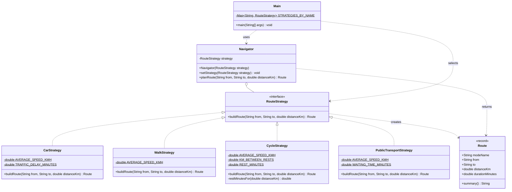

# Assignment 5 — Strategy Pattern Report

## 1. Introduction

The domain of this project is **navigation and route planning**. A user wants to travel from one place to another, and the travel time depends on how they travel. This gives us a family of algorithms that all answer the same question, "how long will this route take?", but in different ways:

- **Car** — average speed of 50 km/h plus a fixed traffic delay.
- **Walk** — average speed of 5 km/h with no extra time.
- **Cycle** — average speed of 15 km/h plus a short rest every 10 km.
- **Public transport** — average speed of 25 km/h plus waiting time at the stop.

The Strategy pattern puts each algorithm in its own class behind a common interface, `RouteStrategy`. The `Navigator` (the context) holds one strategy and can switch to another at runtime without knowing which concrete class it uses.

## 2. UML Class Diagram



## 3. Clean Code

### 3.1 Polymorphism instead of conditionals

Without the pattern, one method must check the travel mode with a `switch`. Every new mode makes this method longer.

**Before**

```java
public double travelMinutes(String mode, double distanceKm) {
    switch (mode) {
        case "car":   return distanceKm / 50 * 60 + 10;
        case "walk":  return distanceKm / 5 * 60;
        case "cycle": return distanceKm / 15 * 60 + (int) (distanceKm / 10) * 5;
        default: throw new IllegalArgumentException(mode);
    }
}
```

**After**

```java
public Route planRoute(String from, String to, double distanceKm) {
    return strategy.buildRoute(from, to, distanceKm);
}
```

The right algorithm is chosen by the object itself. Even in the client, a strategy is picked by name with a `Map` lookup, not with `if` or `switch`:

```java
private static RouteStrategy strategyNamed(String modeName) {
    return Objects.requireNonNull(STRATEGIES_BY_NAME.get(modeName), "Unknown travel mode: " + modeName);
}
```

### 3.2 Meaningful names

Names explain the intention, and magic numbers are replaced by named constants.

**Before**

```java
double t = d / 15 * 60 + (int) (d / 10) * 5;
```

**After**

```java
private static final double AVERAGE_SPEED_KMH = 15.0;
private static final double KM_BETWEEN_RESTS = 10.0;
private static final double REST_MINUTES = 5.0;

double ridingMinutes = distanceKm / AVERAGE_SPEED_KMH * MINUTES_PER_HOUR;
return new Route(MODE_NAME, from, to, distanceKm, ridingMinutes + restMinutesFor(distanceKm));
```

### 3.3 Single Responsibility

Each class has one reason to change. Before, one class planned routes for every mode and also printed them. After, every strategy holds exactly one algorithm, `Route` only holds data and formats it, and `Navigator` only delegates.

**Before**

```java
public class RoutePlanner {
    public void planAndPrint(String mode, String from, String to, double distanceKm) {
        double minutes = mode.equals("car") ? distanceKm / 50 * 60 + 10 : distanceKm / 5 * 60;
        System.out.println(mode + " " + from + " -> " + to + " " + minutes + " min");
    }
}
```

**After**

```java
public final class WalkStrategy implements RouteStrategy {
    @Override
    public Route buildRoute(String from, String to, double distanceKm) {
        double walkingMinutes = distanceKm / AVERAGE_SPEED_KMH * MINUTES_PER_HOUR;
        return new Route(MODE_NAME, from, to, distanceKm, walkingMinutes);
    }
}
```

### 3.4 Algorithm-agnostic context

The `Navigator` depends only on the `RouteStrategy` interface. It does not import or know any concrete strategy, and it rejects a missing strategy early with `Objects.requireNonNull`.

**Before**

```java
public class Navigator {
    private final CarStrategy car = new CarStrategy();
    private final WalkStrategy walk = new WalkStrategy();
    private boolean walking;

    public Route planRoute(String from, String to, double distanceKm) {
        return walking ? walk.buildRoute(from, to, distanceKm) : car.buildRoute(from, to, distanceKm);
    }
}
```

**After**

```java
public final class Navigator {
    private RouteStrategy strategy;

    public void setStrategy(RouteStrategy strategy) {
        this.strategy = Objects.requireNonNull(strategy, "strategy must not be null");
    }

    public Route planRoute(String from, String to, double distanceKm) {
        return strategy.buildRoute(from, to, distanceKm);
    }
}
```

### 3.5 Easy extensibility (Open/Closed)

`PublicTransportStrategy` was added in its own commit as **one new file**. `Navigator`, `Route` and the other strategies were not changed. The client only registers the new strategy.

**Before** — adding a mode means editing existing code:

```java
case "transit": return 8 + distanceKm / 25 * 60;
```

**After** — adding a mode means adding a class:

```java
public final class PublicTransportStrategy implements RouteStrategy {
    private static final double AVERAGE_SPEED_KMH = 25.0;
    private static final double WAITING_TIME_MINUTES = 8.0;

    @Override
    public Route buildRoute(String from, String to, double distanceKm) {
        double ridingMinutes = distanceKm / AVERAGE_SPEED_KMH * MINUTES_PER_HOUR;
        return new Route(MODE_NAME, from, to, distanceKm, WAITING_TIME_MINUTES + ridingMinutes);
    }
}
```

```java
"transit", new PublicTransportStrategy()
```

## 4. Conclusion

The Strategy pattern made the route planner flexible. The travel mode can change at runtime with one `setStrategy` call, a mode can be chosen by name from a `Map`, and a new mode can be added without touching the `Navigator` or the other strategies. Each algorithm is small and easy to read and test on its own.

The cost is more classes: one interface and one class per travel mode, instead of a single method with a `switch`. For only two simple modes this could feel like too much. But as soon as modes have their own extra rules (traffic, rests, waiting time) and new modes keep coming, the extra classes pay off, because every change stays small and local.

## 5. GitHub Repository

<REPO_LINK>
